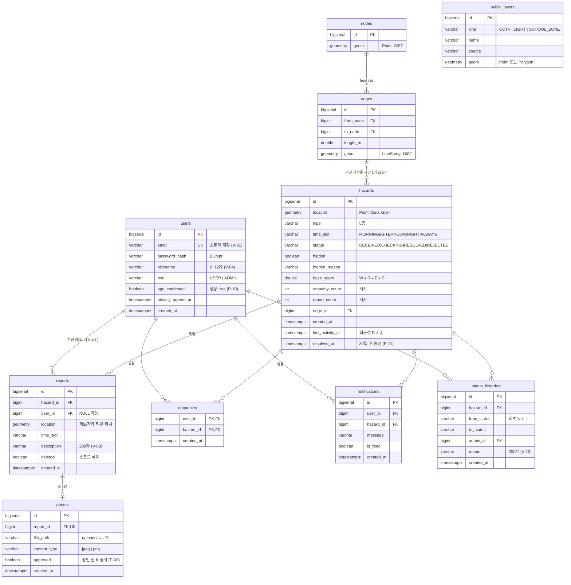

# ERD · DB 스키마

> 실제 스키마의 기준은 `src/main/resources/db/migration/V1__init_schema.sql` 입니다. 이 문서는 그림으로 보는 용도예요.
> 스키마를 바꾸려면 V1 을 고치지 말고 `V2__설명.sql` 을 새로 추가하세요.

## 설계 포인트

| 포인트 | 이유 |
|---|---|
| **제보(reports) ≠ 위험 지점(hazards)** | 공감·처리상태·점수는 지점에, 사진·작성자는 제보에. 지도 마커 1개 = 지점 1개 |
| **`base_score`만 저장** | 시간대 가중치 T는 조회 시각마다 달라서 조회할 때 곱함 |
| **`empathies` 복합 PK** | 같은 사람이 같은 지점에 두 번 공감 못 하게 DB가 막음 (P-03) |
| **`ux_reports_hazard_user` 부분 유니크** | 같은 사람이 같은 지점에 두 번 제보 → `DUP_REPORT` (삭제된 제보는 제외) |
| **`empathy_count`·`report_count` 캐시** | 지도 조회 때마다 COUNT 안 하려고. 변경과 **같은 트랜잭션**에서 갱신 |
| **`reports.user_id` NULL 허용** | 탈퇴해도 제보는 작성자 없이 남김 (P-11) |
| **GiST 공간 인덱스** | 반경 20m 묶기, bbox 조회, 가장 가까운 구간 찾기를 빠르게 |
| **enum 은 VARCHAR + CHECK** | JPA `@Enumerated(EnumType.STRING)` 과 맞추고, 잘못된 값은 DB가 거부 |
| **경로 출발지 테이블 없음** | 출발지(사실상 집 주소)는 저장하지 않음 (P-12) |

## JPA 엔티티 만들 때

- 좌표: `org.locationtech.jts.geom.Point` + `@Column(columnDefinition = "geometry(Point,4326)")` (hibernate-spatial)
- enum: `@Enumerated(EnumType.STRING)` + `com.slink.ansimheung.common.type.*` 사용
- 시간: `OffsetDateTime` (응답이 `+09:00` 형식으로 나감)
- `ddl-auto: validate` 라서 엔티티와 테이블이 다르면 서버가 안 뜸 → 마이그레이션을 먼저 추가
